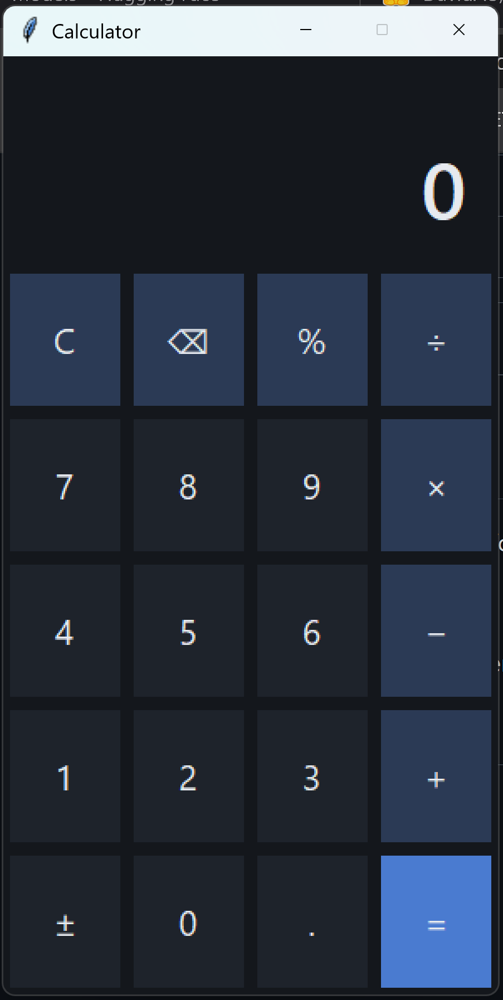

# Calculator

A simple dark-themed calculator for Windows, built with Python and Tkinter.

Run it with: python calculator.py

Unsigned calculator.exe will trigger the “Windows protected your PC” warning. One line saying More info → Run anyway
